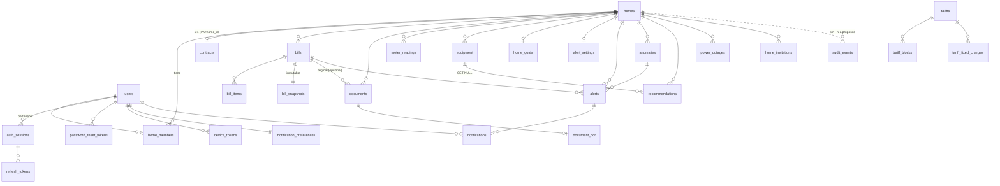

# Auditoría 04 — Base de datos, aislamiento por vivienda, integridad y privacidad

**Modo:** solo lectura sobre el repositorio. Las comprobaciones dinámicas se hicieron en una **base desechable local** (`energy_rd_audit04`, creada desde las migraciones y eliminada al terminar). No se tocó ninguna base real (Neon/Render): **todo lo que depende de producción figura como NO VERIFICADO**.
**Árbol:** `Dev` @ `5e761c6`. PostgreSQL 16.15 (local), Alembic `0023`.

---

## 1. Resumen ejecutivo

| Aspecto | Veredicto |
|---|---|
| Integridad estructural | **Buena**: 32 tablas, claves foráneas con `ON DELETE` explícito, restricciones `CHECK`/`UNIQUE`, 3 restricciones de exclusión (solapes de facturas, tarifas y apagones), todas las fechas con zona horaria, importes en `numeric`. 20 hilos intentando facturas solapadas → 1 aceptada, 19 rechazadas por la base |
| Migraciones | **Buena**: `upgrade base→head` y `downgrade head→base` limpios, sin deriva (`alembic check`); el costo es que los *downgrade* destruyen datos |
| Aislamiento por vivienda (multi-tenant) | **Solo en la aplicación.** Sin RLS, sin roles separados. Defensa en profundidad **ausente** en la base |
| Privacidad | **Parcial**: borrado de cuenta bien diseñado; faltan retención de varias tablas, cifrado de columnas con PII y atribución en la auditoría |
| Respaldos | **Herramientas buenas y probadas en local (10/10)**; sin programación, sin copia externa y sin simulacro contra producción |

**Bloqueante potencial para el lanzamiento: DB-01** (el rol de la aplicación es el dueño de todas las tablas; con ese diseño un error de aplicación o una inyección expone todas las viviendas, y añadir RLS *sin cambiar el rol* no protegería nada — demostrado en §6).

Hallazgos: 1 alta · 6 medias · 5 bajas · 1 informativa. Ninguno se explotó contra datos reales.

---

## 2. Diagrama entidad-relación (simplificado, 32 tablas)

Sin relación con `homes`/`users` (globales o de infraestructura): `tariffs`, `auth_abuse_buckets`, `jobs`, `storage_deletions`, `alembic_version`.

---

## 3. Inventario de tablas y relaciones

| Grupo | Tablas | Tenant |
|---|---|---|
| Identidad | `users` (email único), `auth_sessions`, `refresh_tokens`, `password_reset_tokens`, `device_tokens`, `notification_preferences`, `notifications` | por `user_id` |
| Vivienda | `homes` (`code` único global), `home_members` (PK `home_id,user_id`; roles `owner`/`member`), `contracts`, `home_invitations`, `home_goals`, `alert_settings` | `home_id` |
| Datos energéticos | `bills` (+ `bill_items`, `bill_snapshots`), `meter_readings`, `equipment`, `power_outages` | `home_id` (hijas por `bill_id`) |
| Derivados | `alerts`, `anomalies`, `recommendations` | `home_id` |
| Documentos | `documents`, `document_ocr`, `storage_deletions` (cola de borrado de objetos) | `home_id` (OCR por `document_id`) |
| Infraestructura | `jobs`, `auth_abuse_buckets`, `audit_events`, `alembic_version` | globales (`audit_events` lleva `home_id` sin FK) |
| Catálogo regulado | `tariffs`, `tariff_blocks`, `tariff_fixed_charges` | globales (públicos) |

Integridad referencial (36 FKs, todas con acción explícita): **31 CASCADE**, **5 SET NULL** (`documents.uploaded_by`, `home_invitations.invited_by/accepted_by`, `recommendations.equipment_id/anomaly_id`). Triggers: `bill_snapshots` inmutable (UPDATE/DELETE/TRUNCATE bloqueados salvo huérfano), `documents` (guarda de inserción/actualización + encolado del borrado del objeto). Extensiones: `btree_gist`.

---

## 4. Roles y privilegios

| Hecho comprobado (BD local, creada por las migraciones) | Resultado |
|---|---|
| Rol que usa la aplicación | `energy`: **superusuario** (`rolsuper = t`), `CREATEROLE` no, `BYPASSRLS` no (lo anula por ser superusuario) |
| Dueño de las 32 tablas | `energy` — el **mismo rol** migra y sirve (`alembic upgrade` y la API usan `DATABASE_URL`) |
| RLS activado / forzado | **0 / 0** de 32 tablas; **0 políticas** |
| Otros roles / `GRANT` en migraciones | Ninguno (`git grep` de `GRANT`, `CREATE ROLE`, `POLICY` sin coincidencias) |
| `CREATE` para `PUBLIC` en `public` | No (PostgreSQL 15+) |

**Límite de esta evidencia:** el superusuario es una consecuencia del contenedor/CI de desarrollo. **En Neon el rol por defecto no es superusuario pero sí dueño de la base y de los objetos** (con capacidad de saltarse RLS si no se usa `FORCE`) — **NO VERIFICADO**: no se inspeccionó Neon. Además, `render.yaml` usa la misma `DATABASE_URL` para la migración (`preDeployCommand`) y para servir.

---

## 5. Matriz de aislamiento por vivienda (tenant)

Capa 1 = aplicación (`authorize_home`: membresía + `home_id` en la ruta; bloqueo de la fila de la vivienda en escrituras). Capa 2 = base de datos (RLS): **inexistente**.

| Tabla | Cómo se aísla | Capa 2 (BD) | Evidencia |
|---|---|---|---|
| `bills`, `meter_readings`, `equipment`, `power_outages`, `recommendations`, `anomalies`, `alerts`, `documents`, `contracts`, `home_goals`, `alert_settings`, `home_invitations` | columna `home_id` + todas las consultas de servicio filtran por `home_id` (rutas bajo `authorize_home`) | ✗ | `test_all_private_routes_require_membership_and_token` (3 roles), `test_private_route_inventory_remains_covered` |
| `bill_items`, `bill_snapshots` | solo por `bill_id`; se alcanzan después de `get_bill(home_id, bill_id)` | ✗ | `bill_detail.py:18,59,82` (los 3 puntos parten de una factura ya validada por vivienda) |
| `document_ocr` | por `document_id`; el *worker* lo lee con ids de la cola (confiables); la API lo lee tras validar vivienda | ✗ | `ocr/jobs.py:70-160` |
| `home_members` | PK `(home_id, user_id)`; la fila propia decide el acceso | ✗ | `auth_deps.py:42-61` |
| `notifications`, `device_tokens`, `notification_preferences`, `auth_sessions`, `refresh_tokens`, `password_reset_tokens` | por `user_id` del token | ✗ | `account_settings.py`, `auth.py` |
| `audit_events` | `home_id` sin FK; no se expone por API | ✗ | no hay ruta que la lea (solo exportación/pseudonimización) |
| `jobs`, `storage_deletions`, `auth_abuse_buckets` | internas (worker); el *payload* de los trabajos solo lleva `home_id` | n/a | `jobs.payload` ≤ 8 KB, solo ids |
| `tariffs*` | públicas por diseño | n/a | `GET /tariffs` público |

El contexto de tenant **no se puede manipular desde el cliente**: `home_id` viene de la ruta, se valida contra `home_members` del usuario del token, y el cliente no envía `home_id` en cuerpos. **Pero esa es la única barrera**: no hay `SET LOCAL app.home_id`, ni políticas, ni rol limitado.

Consultas por id sin filtro de vivienda (heurística `db.get(...)`): las 27 coincidencias son de entidades **por usuario** (sesiones, preferencias), **por clave primaria = home_id** (contrato, meta, ajustes de alerta) o **internas del worker**; ninguna recibe un id controlado por el cliente sin pasar antes por el filtro de vivienda.

---

## 6. Pruebas dinámicas ejecutadas (BD desechable)

| # | Prueba | Resultado |
|---|---|---|
| 1 | Con el rol de la app, `SELECT` directo sobre `bills` con 2 viviendas | **Ve las 2** (sin RLS, un fallo de aplicación o una inyección cruza viviendas) |
| 2 | Crear una tabla con `RLS + POLICY` y consultarla con el rol de la app | **Devuelve todas las filas**: el dueño/superusuario ignora la política. *Añadir RLS sin separar roles (y sin `FORCE`) no protegería* |
| 3 | 20 hilos insertan facturas solapadas en la misma vivienda | **1 aceptada, 19 rechazadas** por `ex_bills_home_period_overlap` (la base protege la regla incluso sin el bloqueo de aplicación) |
| 4 | `ana@example.com` y `Ana@Example.com` | **Ambos se insertan** (el `UNIQUE (email)` distingue mayúsculas; el servicio normaliza a minúsculas en `schemas/auth.py:24,88,135`) |
| 5 | Lectura de medidor con valor menor que la anterior vía SQL directo | **Aceptada** (la monotonía solo la impone el servicio) |
| 6 | Factura con `days = 3` en un período de 31 días | **Aceptada** (coherencia solo en aplicación) |
| 7 | `downgrade base` → `upgrade head` | OK (23 pasos cada uno); `alembic check` sin cambios |
| 8 | `scripts/test_db_dr.sh` (respaldo cifrado + restauración + 5 fallos esperados) | **10/10 OK**, 0 bases huérfanas |
| 9 | `EXPLAIN` con 300 viviendas × 365 lecturas (110 k filas) y 7 k facturas | Lecturas, facturas y auditoría usan índices (0.09–0.26 ms). Tablas pequeñas/vacías (alertas, anomalías, jobs, notificaciones, invitaciones) usan *seq scan*: **no concluyente** por volumen; los índices necesarios existen (§8, DB-08) |

---

## 7. Hallazgos

Formato: ID · severidad · confianza · evidencia · escenario · impacto · causa raíz · remediación · prueba de regresión · criterio de cierre.

**DB-01 · ALTA · confianza alta (local) / no verificada (Neon)** — *Sin RLS y con un único rol dueño de todo.*
Evidencia: §4 y pruebas 1–2; `render.yaml` usa la misma `DATABASE_URL` para migrar y servir.
Escenario: una falla de autorización en cualquier endpoint, un `home_id` olvidado en una consulta futura o una inyección SQL devuelve datos de otras viviendas sin que la base lo impida.
Impacto: exposición masiva de datos de hogares (facturas, direcciones, número de cuenta).
Remediación: tres roles — *migrador* (dueño, solo en el paso de release), *aplicación* (sin ser dueño, `NOBYPASSRLS`, solo DML) y *lectura/respaldo*. Activar `ENABLE` + `FORCE ROW LEVEL SECURITY` en tablas con `home_id` y fijar `SET LOCAL app.home_id` por solicitud dentro de `authorize_home`. Mantener la autorización de aplicación (la RLS es la segunda barrera, no su reemplazo). Para tablas hijas (`bill_items`, `bill_snapshots`, `document_ocr`) usar política con `EXISTS` sobre el padre o añadir `home_id` denormalizado.
Prueba: rol de aplicación sin contexto → 0 filas; con contexto de A → nunca filas de B, en cada tabla (matriz parametrizada); `UPDATE/DELETE` cruzado afecta 0 filas.
Cierre: la matriz de §5 con columna "BD" en ✓ para todas las tablas con `home_id`, probada con el rol de aplicación real y verificada en Neon.

**DB-02 · MEDIA · alta** — *Unicidad de correo sensible a mayúsculas.* Prueba 4. Una ruta que escriba `users.email` sin normalizar (script, importación, soporte) permite cuentas duplicadas y bloqueos de acceso/suplantación por homónimo. Remediación: `CREATE UNIQUE INDEX ON users (lower(email))` y `CHECK (email = lower(email))` (o `citext`). Prueba: insertar `A@x.com` con `a@x.com` existente falla. Cierre: restricción en la base + test.

**DB-03 · MEDIA · alta** — *PII sensible en claro en columnas:* `contracts.account_number` (número de cuenta/NIC), `homes.address/city/sector/province/municipality`, `home_invitations.email`, `users.email`; no hay cifrado de columna (`grep` de cifrado solo encuentra el almacenamiento de documentos). Mitigante: cifrado en reposo del proveedor (NO VERIFICADO). Remediación: cifrado de aplicación (envelope, claves versionadas como en `storage`) para `account_number` y dirección, o decisión documentada de aceptar el riesgo con el cifrado del proveedor; mínimo: no copiar esos campos en `audit_events`. Prueba: `SELECT account_number` en la base no devuelve texto legible. Cierre: decisión formal + prueba.

**DB-04 · MEDIA · alta** — *`audit_events` sin atribución, sin retención y con copias de PII.* `actor` es siempre `'pilot'` (`models/audit.py:14,23`): no se puede saber **quién** cambió un dato; el `before/after` guarda la fila completa (incluye `account_number` y dirección en `contracts`/`homes`) y se conserva mientras exista la vivienda; no hay purga. Al borrar una vivienda se pseudonimiza (bien, `account.py:35-38`), pero en viviendas compartidas persiste. Remediación: columna `actor_user_id` (FK `SET NULL`), guardar solo *diff* y campos no sensibles, política de retención (p. ej. 24 meses) y purga programada. Prueba: tras editar el contrato, el evento no contiene `account_number` y sí el `actor_user_id`. Cierre: columna + purga + test.

**DB-05 · MEDIA · alta** — *Retención incompleta.* Hay purga de `jobs` (diaria), `password_reset_tokens` (oportunista), documentos sin confirmar y cola de borrado de objetos. **No hay purga** de `auth_sessions`/`refresh_tokens` vencidos o revocados, `auth_abuse_buckets`, `notifications`, `alerts` descartadas, ni de `home_invitations` vencidas/revocadas (conservan el correo de un tercero indefinidamente). Impacto: crecimiento sin límite y datos personales de terceros retenidos sin motivo. Remediación: trabajo `maintenance.purge` con plazos escritos (sesiones +30 d tras vencer, cubos de abuso +7 d, invitaciones +90 d, notificaciones 12 m). Prueba: filas vencidas desaparecen; las vigentes no. Cierre: política en el aviso de privacidad + test.

**DB-06 · MEDIA · alta** — *Sin tiempos de espera en la base ni en el pool.* `statement_timeout = lock_timeout = idle_in_transaction_session_timeout = 0` (valores efectivos del servidor); `create_engine` sin `connect_args` (`database.py:11-12`). Cada escritura toma `FOR UPDATE` sobre la fila de la vivienda (`auth_deps.py:52-56`): una transacción lenta o colgada bloquea todas las escrituras de esa vivienda, y las solicitudes se acumulan hasta agotar el pool (5+5 conexiones, `pool_timeout` 10 s). Remediación: `options=-c statement_timeout=30s -c lock_timeout=5s -c idle_in_transaction_session_timeout=60s`; confirmar el límite de conexiones de Neon (y la compatibilidad con su *pooler*). Prueba: sesión que mantiene el bloqueo → la segunda escritura falla en ≤ 5 s con 409/503, no se cuelga. Cierre: configuración + prueba.

**DB-07 · MEDIA (privacidad) · media** — *Retención en respaldos vs. derecho de supresión.* El respaldo cifrado conserva los datos de cuentas ya borradas hasta que caduca (propuesta: 35 días); la política de privacidad aún no lo dice (`docs/ops/DISASTER_RECOVERY.md`). Remediación: declararlo y definir el procedimiento de re-aplicar borrados tras una restauración. Cierre: texto legal aprobado + procedimiento en el runbook.

**DB-08 · BAJA · alta** — *8 claves foráneas sin índice de soporte:* `alerts.bill_id`, `alerts.basis_bill_id`, `alerts.anomaly_id`, `anomalies.bill_id`, `documents.uploaded_by`, `home_invitations.accepted_by`, `recommendations.equipment_id`, `recommendations.anomaly_id`. Hoy irrelevante por volumen; el borrado en cascada de una factura/vivienda hará *seq scan* en esas tablas. Remediación: índices (parciales donde la columna sea nula). Prueba: `EXPLAIN` del `DELETE` de una factura usa índice. Cierre: migración nueva.

**DB-09 · BAJA · alta** — *Reglas de negocio solo en la aplicación* (pruebas 5–6): monotonía de lecturas, `days` vs. período, "siempre hay al menos un propietario", una factura por período con mismo `days`. Aceptable mientras la única vía de escritura sea la API; cualquier script de soporte o importación puede violarlas. Remediación: *constraint trigger* para la monotonía y documentar que los accesos directos deben pasar por servicios. Cierre: trigger o decisión documentada.

**DB-10 · BAJA · alta** — *Migraciones:* las 23 son reversibles estructuralmente, pero **todos los `downgrade` destruyen datos** (tablas/columnas; el de `0020` borra alertas). No hay política *expand/contract* ni prueba de compatibilidad N-1 con la versión desplegada; en producción `MIGRATE_ON_START` está prohibido por la guarda de configuración y se usa un paso único de release (bien). Remediación: documentar que en producción el *rollback* es "restaurar/PITR", no `downgrade`; exigir migraciones aditivas (expand/contract). Cierre: regla escrita en `docs/deploy` + revisión en el CI de migraciones destructivas.

**DB-11 · BAJA · media** — *`homes.code` único global y elegido por el cliente* (`schemas/home.py:25`): un `409` al crear una vivienda con un `code` ajeno revela que ese código existe en otro hogar. Remediación: generar `code` en el servidor o ignorarlo en el alta de usuarios, o devolver un error genérico. Cierre: test de que dos usuarios pueden usar el mismo `code` o que el error no revela existencia.

**DB-12 · BAJA · media** — *Sin tope de viviendas por usuario* (`homes.create_home` no cuenta): un usuario autenticado puede crear viviendas sin límite (abuso de almacenamiento). Remediación: límite configurable + rate limit. Cierre: test.

**DB-13 · INFORMATIVO** — *Procedencia y calidad del dato.*
- `bills.source ∈ {manual, seed}`, `meter_readings.source = manual`. Una factura confirmada desde OCR queda como `manual`; su origen se reconstruye por `documents.bill_id` + `document_ocr` + `bill_snapshots.origin ∈ {creation, migration}` (inmutable por triggers). Es trazable, pero no hay un campo único "origen del valor".
- Estimaciones/inferencias (`anomalies`, `recommendations`) se guardan con su explicación y evidencia (≤ 4 KB), y la **etiqueta de calidad** (REAL/ESTIMADO/PROYECTADO/INFERIDO) se calcula en la API (no se almacena): no hay riesgo de mezclar mediciones con estimaciones en la base, porque estas últimas viven en tablas derivadas.
- Unidades: kWh/RD$ en columnas con nombre y `numeric` fijo; periodos con `daterange`/`tstzrange`; todas las marcas de tiempo con zona.
- Datos de demostración (`seed`) están marcados y la configuración de producción impide sembrar.

---

## 8. Evaluación de migraciones

| Aspecto | Resultado |
|---|---|
| Cadena completa | 23 migraciones; `upgrade` desde vacío, `downgrade base`, `upgrade head` y `alembic check`: **OK** |
| Datos en `upgrade` | `0003` (reetiqueta alertas), `0011` (siembra `bill_snapshots` de facturas existentes), `0014` y `0020` (backfills): no destructivos |
| Operaciones destructivas en `upgrade` | Ninguna `DROP TABLE/COLUMN` ni `DELETE`; `0011` usa `TRUNCATE` solo como *trigger* de protección |
| Bloqueos / tiempo de inactividad | No evaluado con volumen; las tablas crecientes (`meter_readings`, `audit_events`) no tienen migraciones pesadas hoy |
| Compatibilidad con versión desplegada | Sin política escrita (DB-10) |
| Producción | Paso único de release (guarda de configuración + `preDeployCommand` de Render); **ejecución real NO VERIFICADA** |

---

## 9. Evaluación de respaldos y recuperación

| Aspecto | Evidencia | Estado |
|---|---|---|
| Respaldo lógico cifrado (`age`), permisos 600, `sha256` + manifiesto con revisión y huella de esquema | `scripts/db_backup.sh`; autoprueba 10/10 | **Probado en local** |
| Restauración en base desechable con verificación (revisión, huella, triggers, filas) | `scripts/db_restore_verify.sh`; 0.2 s con 63 KB | **Probado en local**, tiempo no extrapolable |
| Fallos esperados (clave equivocada, archivo manipulado, sin manifiesto, clave privada como destinatario) | autoprueba | **Probado** |
| Programación diaria, copia fuera de la cuenta/región, retención 35 d | `docs/ops/DISASTER_RECOVERY.md` ("pendiente") | **No existe** |
| PITR de Neon, restauración de rama, ventana según plan | documentado como objetivo | **NO VERIFICADO** |
| Respaldos de los originales (bucket) | "activar versionado" | **NO VERIFICADO** |
| RPO/RTO | propuestos (≤ 5 min PITR, ≤ 24 h respaldo, ≤ 1 h BD) | **Objetivos, no medidos** |
| `--no-owner --no-acl` | los roles/permisos no viajan en el respaldo | Si se implementa DB-01, el script de restauración debe recrear roles y `GRANT` |

---

## 10. Riesgos de integridad y privacidad (resumen)

- **Integridad:** bien cubierta por la base para duplicados/solapes/rangos; las reglas de monotonía y coherencia de `days` dependen de la aplicación (DB-09).
- **Privacidad:** PII en claro (DB-03), auditoría sin atribución y con copias (DB-04), retención incompleta (DB-05) y en respaldos (DB-07).
- **Disponibilidad:** bloqueo por vivienda sin tiempos de espera (DB-06).

---

## 11. Pruebas recomendadas y criterios de aceptación

1. **Matriz RLS parametrizada** (tabla × operación × vivienda propia/ajena/sin contexto) con el rol de aplicación real → 0 filas ajenas, 0 modificaciones ajenas. *(cierra DB-01)*
2. **Test de roles:** el rol de la aplicación no es dueño, no es superusuario, no puede `CREATE/ALTER/DROP`. *(DB-01)*
3. **Restricción `lower(email)`** y test de duplicado por mayúsculas. *(DB-02)*
4. **Test de auditoría:** editar contrato/vivienda → evento con `actor_user_id` y sin PII; purga por antigüedad. *(DB-03/04)*
5. **Test de retención:** sesiones/tokens/cubos/invitaciones/notificaciones vencidos se purgan, los vigentes no. *(DB-05)*
6. **Test de bloqueo:** una transacción que retiene `FOR UPDATE` de la vivienda no cuelga a la siguiente más de `lock_timeout`. *(DB-06)*
7. **`EXPLAIN` del borrado en cascada** de factura/vivienda con volumen. *(DB-08)*
8. **Simulacro de restauración con el volumen real** y registro de fecha/tiempo; verificar PITR en Neon. *(DB-07, §9)*
9. **CI:** comprobar que ninguna migración nueva contenga `DROP`/`DELETE` sin marca de aprobación. *(DB-10)*

---

## 12. Limitaciones

No se inspeccionó Neon (roles reales, cifrado en reposo, límite de conexiones, PITR); no se probó con volumen de producción; la heurística de "consultas sin filtro de vivienda" es estática y no sustituye una revisión consulta por consulta (auditoría 06); no se evaluó el rendimiento bajo carga concurrente (auditoría 08).

*Este informe no certifica seguridad ni cumplimiento legal.*
